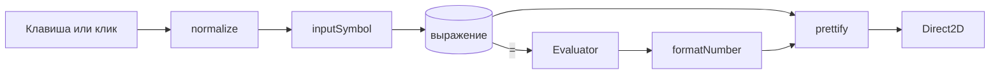

<div align="center">


# Калькулятор

**Чёрно-белый. Мгновенный. Считает так, как учили в школе.**


</div>

---

## С чего всё началось

Набираешь во встроенном калькуляторе Windows:

```
4 × 12 + 44 × 2 − 12
```

В обычном режиме он считает каждое действие сразу, слева направо, и выдаёт **172**.
Правильный ответ **124**, потому что умножение идёт раньше сложения.

Этот калькулятор появился ради одной вещи: набрать выражение целиком, нажать `=` и получить честный ответ.

## Что внутри

Один файл `calc.cpp`, около тысячи строк. Никаких Qt, WinUI, Electron и рантаймов: только системные DLL, которые и так есть в каждой Windows.

| Слой | Чем сделан |
|---|---|
| Окно и ввод | голый Win32 API |
| Отрисовка | Direct2D со сглаживанием |
| Текст | DirectWrite, оттенки серого вместо цветного ClearType |
| Рамка окна | DWM: чёрный заголовок, тёмная граница, без системного меню |
| Иконка | нарисована скриптом и вшита в exe как ресурс |

Запускается быстрее, чем успеваешь отпустить кнопку мыши. В простое процессор не тратится вообще: таймер анимации живёт только пока что-то двигается.

## Как он думает

Выражение разбирает рекурсивный спуск. Вся математика укладывается в три правила:

```
expression = term   { ("+" | "-") term }
term       = factor { ("*" | "/") factor }
factor     = ("+" | "-") factor | "(" expression ")" | number
```

Приоритет операций получается сам собой из вложенности: `term` всегда собирается раньше, чем до него доберётся `expression`.



## Он прощает опечатки

Ввод проверяется на лету, поэтому сломать выражение почти невозможно:

| Нажал | Увидел | Что произошло |
|---|---|---|
| `2(3+4` | `2 × (3 + 4` | умножение перед скобкой дописалось само |
| `5+*2` | `5 × 2` | новый оператор заменил старый |
| `5*-3` | `5 × −3` | а минус после умножения стал знаком числа |
| `007` | `7` | ведущие нули съедаются |
| `.5` | `0.5` | ноль перед точкой появляется сам |
| `1..5` | `1.5` | вторая точка в числе игнорируется |
| `3,5` | `3.5` | запятая с numpad на русской раскладке тоже точка |
| `(1+2)*(3` `=` | `9` | незакрытые скобки закрываются при подсчёте |
| `=` `+5` | продолжение от ответа | оператор после результата цепляется к нему |
| `=` `⌫` | выражение вернулось | можно поправить и пересчитать |

## Числа без мусора

Внутри обычный `double`, но ответ округляется до 15 значащих цифр, поэтому:

```
0.1 + 0.2            = 0.3                  а не 0.30000000000000004
1 ÷ 3                = 0.333333333333333
9999999999 × 9999999999 = 9.999999998e+19
2 ÷ 0                = Деление на ноль
```

Форматирует `std::to_chars`: без локалей, без `printf`, одинаково на любом компиляторе.

## Типографика

Мелочи, которые не видно, пока их не убрать:

- разряды разделены **тонким пробелом** (U+2009): число `1234567` на экране выглядит как 1 234 567;
- минус настоящий, **типографский** (U+2212), а не дефис с клавиатуры;
- `×` и `÷` вместо `*` и `/` - только на экране, внутри всё хранится в ASCII;
- длинное выражение плавно **сжимается** до 40% размера матрицей масштабирования вокруг правого нижнего угла, а дальше показывается хвост;
- шрифт выбирается по оптическому размеру: **Segoe UI Variable Text** на кнопках и **Display** для большого ответа;
- значки операторов взяты из **Segoe Fluent Icons** (`E947`-`E94E`), как в системном калькуляторе; на Windows 10 подменяются MDL2, на совсем старых - обычным текстом.

## Анимация одной формулой

Никаких ключевых кадров и кривых Безье. Каждая кнопка просто тянется к цели:

```
value += (target − value) · (1 − e^(−Δt / τ))
```

| | τ |
|---|---|
| наведение | 70 мс |
| нажатие | 120 мс |

Формула не зависит от частоты кадров: при любом Δt движение выглядит одинаково.

## Палитра

Ни одного цветного пикселя. Только серый:

| Что | Тон |
|---|---|
| фон | `#000000` |
| служебные кнопки | `#111111` |
| цифры | `#1E1E1E` |
| операторы | `#343434` |
| история | `#787878` |
| подписи служебных | `#AAAAAA` |
| `=` и текст | `#FFFFFF` |

## Иконка

Белый квадрат, чёрное «равно». Восемь размеров от 16 до 256 пикселей.
Маленькие размеры не уменьшены из большого, а нарисованы заново с привязкой к пиксельной сетке, поэтому даже в трее полоски остаются чёткими, без мыла.

---

<div align="center">
<sub>Сделано в три часа ночи, потому что 172 ≠ 124.</sub>
</div>
